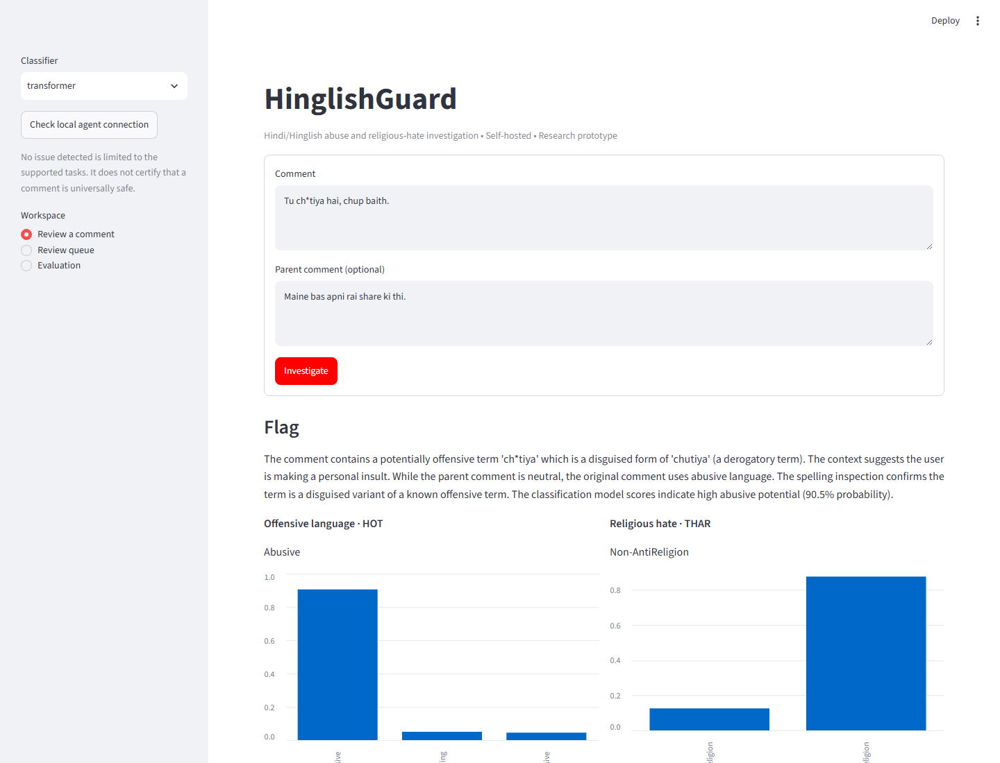
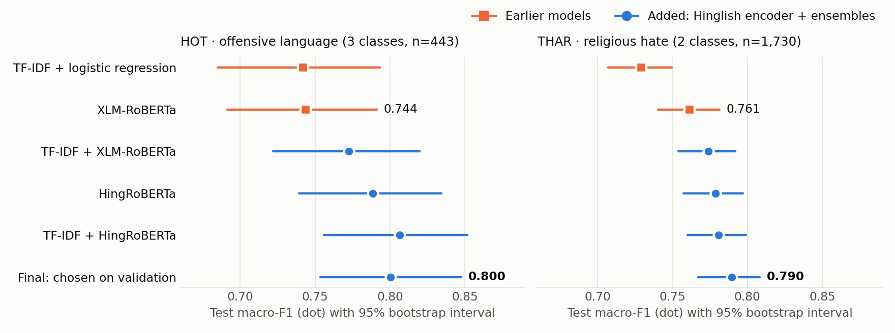

# HinglishGuard

**A Discord moderation bot for Hindi and Hinglish.** It watches a server's messages, removes abuse and religious hate with a warning, and sends anything uncertain to a human moderator. Underneath are fine-tuned classifiers plus a local tool-calling agent that decodes disguised slurs ("ch*tiya", "c h u t i y a") and reads the message being replied to.

   



Moderating Hinglish is hard for off-the-shelf tools: it mixes scripts, spells the same word many ways, and disguises slurs ("ch*tiya", "c h u t i y a", "ch0tiya"). HinglishGuard trains its own classifiers on two research datasets, then lets a small local LLM *investigate* (normalise spellings, read the parent comment, consult policy) under strict, validated tool rules. Anything uncertain goes to a human reviewer instead of being guessed.

> Research prototype, tested in a live Discord server. Not a production moderation service. See [research limits](#research-limits-and-sources).

## Live on Discord

```
member posts / edits a message
        │
        ▼
HinglishGuard bot (discord.py, queue of ≤500 messages, every edit re-checked)
        │
        ├─ abuse classifier + religious-hate classifier (calibrated, ≥90%-precision gates)
        ├─ local Qwen3-4B agent: spelling variants, replied-to context, policy
        ▼
   FLAG ──► delete message + respectful warning in channel
   HUMAN_REVIEW ──► kept, logged for a moderator
   NO_ISSUE ──► nothing happens
        │
        ▼
audit log (SQLite): every message, revision, verdict and evidence
```

**Live test (4 Nov 2026, a test server):** 19 messages handled in one session. **7 removed** with a warning posted, **12 routed to human review**, 0 operational errors. Configuration is per server and channel; deletion by the LLM alone is off by default, so only classifier-confirmed abuse is removed automatically. Setup and options: [Discord bot](#discord-bot).

## Results

Held-out test sets that no model or threshold ever saw during training or tuning. Dots are macro-F1; whiskers are 1,000-round bootstrap 95% intervals.

<picture>
  <source media="(prefers-color-scheme: dark)" srcset="docs/media/results-dark.png">
  
</picture>

| Model | HOT macro-F1 (95% CI) | HOT *hate-inducing* F1 | HOT auto-decided | THAR macro-F1 (95% CI) | THAR auto-decided |
|---|---|---|---|---|---|
| TF-IDF + logistic regression | 0.742 (0.685–0.793) | 0.575 | 76% | 0.729 (0.707–0.749) | 16% |
| XLM-RoBERTa | 0.744 (0.691–0.791) | 0.623 | 78% | 0.761 (0.740–0.781) | 15% |
| TF-IDF + XLM-RoBERTa ensemble | 0.773 (0.722–0.820) | 0.638 | 86% | 0.774 (0.754–0.792) | 35% |
| HingRoBERTa | 0.789 (0.739–0.834) | 0.667 | 93% | 0.779 (0.757–0.797) | 38% |
| **TF-IDF + HingRoBERTa ensemble** | **0.806 (0.756–0.852)** | **0.696** | 89% | **0.781 (0.760–0.799)** | **43%** |

HOT: 443 test comments, 3 classes (non-offensive / hate-inducing / abusive). THAR: 1,730 test comments, binary anti-religion. 14,490 records after de-duplication, split so near-duplicates never cross train/test.

**What changed and what it means**

- **A Hinglish-pretrained encoder beats a general multilingual one.** Swapping XLM-RoBERTa for [HingRoBERTa](https://huggingface.co/l3cube-pune/hing-roberta) (same size, pretrained on Hinglish tweets) lifted HOT from 0.744 to 0.789 and the hardest class, *hate-inducing* (44 test examples), from 0.62 to 0.67. Training takes about 5½ minutes on one 16 GB GPU.
- **TF-IDF and the transformer make different mistakes, so averaging their calibrated probabilities helps.** The best system reaches 0.806 on HOT and 0.696 on the hate class.
- **Far more decisions can be automated safely.** "Auto-decided" is the share of comments the system may decide without a human because its score passes gates that require ≥90% precision and ≥30 supporting examples. On THAR this rose from 15% to 43%, so the share left for human review fell from 85% to 57% (about two-thirds as many comments).
- **Honest caveats.** On HOT the intervals still overlap (443 test comments is small), so the gain over XLM-RoBERTa is likely but not proven. Auto-decided rates are measured on the validation set the gates were fitted on, so treat them as estimates. The agent's own benefit is **not yet benchmarked**: its challenge sets are drafts awaiting human review (see [Evaluation and review work](#evaluation-and-review-work)).

## How it works

```
comment (+ optional parent comment)
   │
   ├─► HOT classifier  ──┐   abuse: non-offensive / hate-inducing / abusive
   ├─► THAR classifier ──┤   religious hate: anti-religion / not
   │                     ▼
   │        calibrated probabilities ─► decision gates (≥90% validation precision)
   │                     │                   │
   │              uncertain           confident ─► automatic verdict
   ▼                     ▼
local Qwen3-4B agent (Ollama, tool calling)
   tools: inspect_spelling · get_context · get_policy · classify_abuse · classify_religious_hate
   rules: evidence must be exact quotes · max 4 turns / 8 tool calls / 120 s · can escalate, never bypass gates
   ▼
FLAG / NO_ISSUE / HUMAN_REVIEW  ──► Streamlit review queue, human overrides, CSV/JSON export, Discord bot
```

- **Classifiers:** TF-IDF (word + character n-grams) with logistic regression; XLM-RoBERTa and HingRoBERTa fine-tuned with class-weighted loss; temperature-calibrated on validation; ensembles average calibrated probabilities.
- **Agent safety:** comments are treated as untrusted data, not instructions. Classifiers only accept the original text or a candidate produced by the spelling tool. Fabricated evidence, unapproved tools or invalid JSON are rejected. Failures degrade to HUMAN_REVIEW, never to a guessed verdict.
- **Reproducibility:** dataset downloads are pinned to exact commits with checksums; every model records the hash of the split it was trained on, and evaluation refuses to run if the split changed.

## Quick start

```bash
git clone https://github.com/chiragduhoon/hinglishguard && cd hinglishguard
python -m venv .venv && source .venv/bin/activate        # Windows: .venv\Scripts\activate
pip install -e '.[dev]'
pytest -q                                                # 41 tests, no data/GPU/Ollama needed

python -m hinglishguard.cli download && python -m hinglishguard.cli prepare
python -m hinglishguard.cli train --task hot && python -m hinglishguard.cli train --task thar   # TF-IDF, CPU, seconds
streamlit run app.py
```

Transformer training needs a CUDA GPU (see below). For the agent, run [Ollama](https://ollama.com) locally with `qwen3:4b-instruct`. Without it, investigations show the classifier findings and fall back to HUMAN_REVIEW.

## Reproduce data and training

From the project root, using the activated environment:

```bash
python -m hinglishguard.cli download
python -m hinglishguard.cli prepare
python -m hinglishguard.cli train --task hot
python -m hinglishguard.cli train --task thar
python -m hinglishguard.cli evaluate --task hot
python -m hinglishguard.cli evaluate --task thar
python -m hinglishguard.cli evaluate-keywords
```

Downloads pin each source to a retrieved commit and store checksums plus the source README. `prepare` preserves original text, quarantines conflicting duplicate groups and writes a global split manifest. HOT is headerless and contains blank rows; THAR uses `Comment` and `SubTask1`. UTF-8 is tried first, then Windows-1252 for the source files that require it.

Read `data/processed/annotation_review.json`: it samples up to 50 examples per class and leaves review fields blank. Complete these checks and document label disagreements before making academic claims about annotation quality. Do not silently replace source labels.

For the planned transformer models, train **sequentially**, with Ollama unloaded:

```bash
ollama stop qwen3:4b-instruct
python -m hinglishguard.cli train --task hot --backend transformer
python -m hinglishguard.cli train --task thar --backend transformer
python -m hinglishguard.cli evaluate --task hot --backend transformer --device cuda
python -m hinglishguard.cli evaluate --task thar --backend transformer --device cuda
```

If CUDA memory is insufficient, rerun training with `--batch-size 4`. Training uses 192 tokens, effective batch size 16, three epochs, class-weighted loss, seed 42, learning rate 2e-5 and validation macro-F1 selection. Temperature and automatic-decision thresholds are fitted only on validation data. Held-out test metrics are written separately.

After training, start Streamlit on Chirag:

```bash
export HG_CLASSIFIER_DEVICE=cpu
python -m streamlit run app.py --server.address 127.0.0.1 --server.port 8501 --server.headless true --browser.gatherUsageStats false
```

From your laptop, replace `USER@HOST` with the working SSH destination:

```bash
ssh -L 8501:127.0.0.1:8501 USER@HOST
```

Open http://127.0.0.1:8501 and choose `transformer` in the sidebar. CPU classifier inference leaves GPU memory for the quantized agent. Do not publicly expose port 11434.

### Model experiments (executed)

All selection, calibration and gate fitting uses the validation split only; each test set is scored once per model.

```bash
# Hinglish-pretrained encoder, trained beside the existing model (artifacts/<task>/hingroberta)
python -m hinglishguard.cli train --task hot  --backend transformer --device cuda --base-model l3cube-pune/hing-roberta --output-name hingroberta
python -m hinglishguard.cli train --task thar --backend transformer --device cuda --base-model l3cube-pune/hing-roberta --output-name hingroberta

# Ensembles: average calibrated probabilities of any trained models, fit new gates on validation
python -m hinglishguard.cli calibrate-ensemble --task hot --members tfidf,transformer
python -m hinglishguard.cli calibrate-ensemble --task hot --members tfidf,hingroberta --output-name ensemble-hing --device cuda

# Held-out evaluation (writes evaluation.json with macro-F1 and its bootstrap 95% interval)
python -m hinglishguard.cli evaluate --task hot --backend ensemble-hing --device cuda

# Results chart for this README
python scripts/plot_results.py
```

Any trained folder under `artifacts/<task>/` (for example `hingroberta` or `ensemble-hing`) appears automatically in the Streamlit sidebar, the evaluation screen and every `--backend` option. Still open: seed variance (`--seed 13`, `--seed 7`) and MuRIL as a third encoder.

### Settings

`hinglishguard/settings.py` is the single place for the agent model and Ollama endpoint. Override with `HG_AGENT_MODEL` and `HG_OLLAMA_HOST`; the host must still be loopback (`http://127.0.0.1:11434` or `http://localhost:11434`).

## Investigations and CSV files

```bash
python -m hinglishguard.cli review 'Is policy se main sehmat nahi hoon.' --parent 'Aapki rai kya hai?'
```

CSV columns: `text` required; `id,parent_id,parent_text` optional. Use UTF-8, up to 100 rows and 2 MB. A sample is in `examples/comments.csv`. Generated IDs include text and supplied context. Reimporting an identical comment does not duplicate it; reusing an explicit ID for different content is rejected.

The queue supports stepping through comments or automatic continuation, pausing between investigations and human overrides. CSV export neutralizes spreadsheet formulas; JSON export preserves original text. SQLite retains original predictions and appends overrides without retraining.

## Agent behavior

The agent can call `classify_abuse`, `classify_religious_hate`, `inspect_spelling`, `get_context` and `get_policy`. Classifiers only accept the original text or a candidate previously produced by the spelling tool. Context lookup is restricted to the current case's supplied parent text.

Policy-required checks prevent skipping supplied context, suspicious spellings and quotation/counterspeech checks. The model selects tool calls and optional follow-ups. Missing required checks defer the verdict; positive classifier findings with possible counterspeech are escalated conservatively.

The app validates exact evidence substrings. It rejects unapproved tools, arbitrary classifier text, fabricated evidence and invalid final JSON. Comments are untrusted data, not executable instructions. Observable tool events are recorded; hidden model reasoning is not requested or stored.

Maximum: four model turns, eight tool calls and a 120-second investigation deadline, with one transient-error retry. If final evidence quotes are not exact substrings, the agent gets one correction turn (recorded as `evidence_repairs`); a second failure is an investigation failure. The application stops waiting at the deadline; Python cannot forcibly kill an in-progress native classifier call, so a timed-out background call may finish after the review outcome is saved. Ollama requests also have request timeouts.

Automatic branches require at least 90% precision and 30 supporting examples **on validation data**. This is not a guarantee of test or deployment precision. A model branch that cannot meet these criteria is disabled. The agent can escalate, never bypass deterministic gates. Conflicting normalized predictions, unresolved references, unchecked quotation cases, truncation and operational failures produce HUMAN_REVIEW.

The spelling tool proposes (never asserts) candidates for repeated letters, reviewed aliases, look-alike characters between letters (`ch0tiya` → `chotiya`, `m@darchod` → `madarchod`) and spaced-out letters (`c h u t i y a` → `chutiya`). Standalone numbers, prices and `@mentions` are left unchanged. Devanagari↔Roman transliteration is not implemented.

## Discord bot

```powershell
$env:DISCORD_TOKEN = '<bot token>'      # preferred; config/discord.token is only a fallback
.\.venv\Scripts\python.exe -m hinglishguard.discord_bot
```

Copy `config/discord.example.json` to `config/discord.local.json` and list the allowed server/channel IDs. Both local files are git-ignored and excluded by `scripts/package_source.py`.

| Key | Default | Meaning |
|---|---|---|
| `backend` | `transformer` | Classifier backend |
| `max_queue` | `500` | Pending messages before new ones go to human review |
| `community_profanity_rule` | `false` | Ask the local LLM to re-check comments the classifiers left in HUMAN_REVIEW |
| `community_llm_can_delete` | `false` | Let a FLAG from that LLM re-check delete messages. Off by default: it is one 4B-model judgement with no benchmark validation, so it is audited as `HUMAN_REVIEW_community_llm_suggested_removal` instead |
| `send_warnings` | `false` | Post a respectful warning after a deletion |

The bot logs full tracebacks for failures, writes its audit table off the event loop, and keeps at most 10,000 message revisions in memory.

## Evaluation and review work

Drafts already exist. Do not regenerate over reviewed files:

```bash
python -m hinglishguard.cli challenge-drafts
```

Manually inspect `data/challenges/conversations.json` and `spelling.json`. Correct draft labels/meaning-preservation errors, set `reviewed` to true, fill `reviewer`, and document decisions. Review development conversations first, tune on those 40 only, then freeze configuration before reviewing/running the remaining 80 test cases. Related variants must retain their group/partition.

```bash
python -m hinglishguard.cli evaluate-spelling --backend transformer
python -m hinglishguard.cli evaluate-challenges --backend transformer --partition development
python -m hinglishguard.cli freeze
python -m hinglishguard.cli evaluate-challenges --backend transformer --partition test
```

Challenge evaluation compares classifiers, deterministic normalization, local LLM alone, full agent and agent without context. It reports action macro-F1, automatic coverage, accuracy on decided cases, false flags, review rate, tool calls and latency. It refuses unreviewed drafts. Single-author synthetic challenges do not establish real-world Instagram performance. Compare errors and coverage together; all-review systems are not automatically better.

HOT keyword evaluation is binary positive/not-positive and must not be compared directly to HOT three-class macro-F1. The published HOT lexicon can overlap test vocabulary. THAR keyword features are derived from training rows only.

## Tests

```bash
python -m pytest -q
```

In the restricted Windows workspace, put the temporary directory outside the project. Earlier runs left `.test-*` folders owned by a different Windows account that cannot be deleted without administrator rights:

```powershell
.\.venv\Scripts\python.exe -m pytest -q -p no:cacheprovider --basetemp "$env:TEMP\hinglishguard-pytest"
```

Lint (real-bug rules only; configured in `pyproject.toml`): `ruff check .`. GitHub Actions (`.github/workflows/ci.yml`) runs lint plus tests on Python 3.11 and 3.13; tests need no datasets, weights, GPU or Ollama.

Tests cover decision gates, evidence verification, normalization conflicts, context isolation, rejected tool calls, timeouts, limits, CSV validation, persistent overrides, source parsing, leakage grouping and the three Streamlit screens.

## Presentation and live smoke checks

```bash
python -m pip install -e '.[presentation]'
python scripts/build_presentation.py
python scripts/smoke_agent.py
```

The generated deck and confusion-matrix charts are in `artifacts/presentation`. `artifacts/live_smoke.json` records the executed live checks separately from benchmark results. A prepared five-minute demonstration script is in `docs/DEMO.md`; any recorded preview must be described according to its actual length.

To reproduce a captioned recording of the real deployed interface:

```bash
python -m pip install -e '.[demo]'
python -m playwright install chromium
python scripts/record_demo.py
```

This records actual interface actions through the SSH tunnel. It does not synthesize classifier responses or benchmark outcomes.

Included outputs:

- Five-minute captioned live recording and presentation deck: attached to the [GitHub release](../../releases) (too large for the repository).
- [Experiment report](docs/REPORT.md).
- [Current build status](STATUS.md).

## Research limits and sources

HOT categories are Non-offensive, Hate-inducing and Abusive. Mapping `0/1/2` is supported by source counts matched to Table 2 of the paper; an annotation audit is still required. THAR's literal AntiReligion annotation is not a universal definition of religion-targeted hate. Non-hate THAR examples may still contain profanity. Neither model predicts all forms of discrimination or understands every dialect equally.

- HOT: https://github.com/sawan16/Hinglish-Offensive-Text-Classification
- Mathur et al., 2018: https://aclanthology.org/W18-5118/
- THAR: https://github.com/aakash-dl/THAR
- XLM-RoBERTa: https://huggingface.co/FacebookAI/xlm-roberta-base
- HingRoBERTa (Nayak & Joshi, 2022): https://huggingface.co/l3cube-pune/hing-roberta
- Ollama tool use: https://docs.ollama.com/capabilities/tool-calling

HOT specifies research use and citation. THAR has no standalone license in the observed repository; do not assume unrestricted redistribution. This project supplies preparation scripts rather than treating downloaded comments as redistributable product content.
